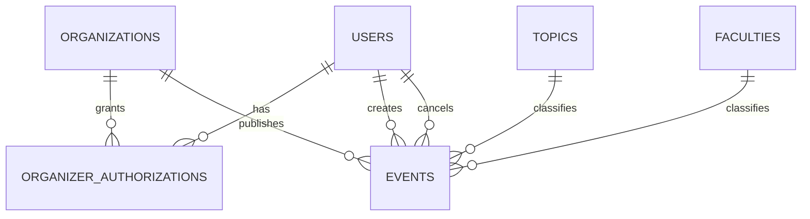
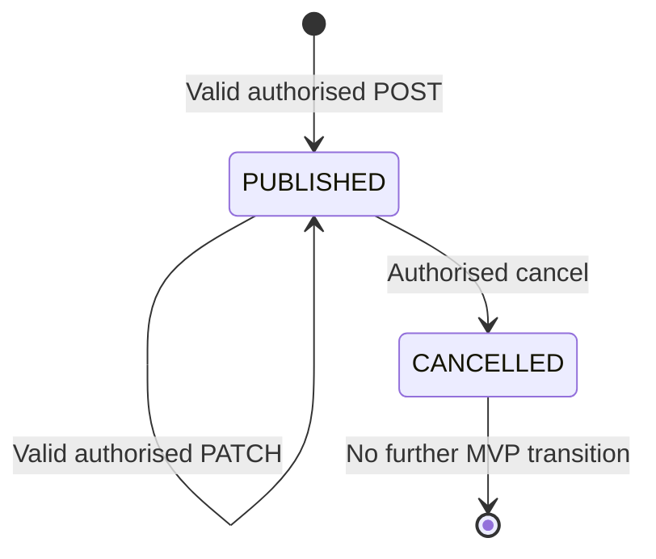

# AlmaMater — MVP Data Model and Persistence Contract

**Practice:** 4.3 — Technical contracts  
**Status:** Complete MVP contract draft; pending final team sign-off on the explicitly listed assumptions  
**Date:** 2026-10-28  
**Related:** [`api-contracts.md`](api-contracts.md), [`requirements.md`](requirements.md), [`user-stories/`](user-stories/)

## 1. Purpose and scope

This document specifies the logical relational data model for the AlmaMater MVP: verified NaUKMA users, student organisations and their authorised organisers, structured events, and fixed topic/faculty dictionaries. It covers the **current canonical** `docs/requirements.md` scope and its `docs/user-stories/` acceptance criteria.

It deliberately does **not** model user subscriptions, email notifications (US-45), draft persistence (US-10), student applications/RSVP, moderation queues, automated social posting, analytics, user profiles, or event requirements/prerequisites (US-18). These are outside the current MVP. The earlier `raw_research_output/p3/3.4_mvp_story_refinement.md` is a historical proposal; the canonical requirements and individual story files take precedence if they differ.

### 1.1 Working decisions requiring team confirmation

| ID | Contract baseline used below | Reason / impact |
| --- | --- | --- |
| D-01 | **All readers and organisers authenticate** using an institution-managed account; there is no separate local registration or password. | Reflects the 2026-10-28 team discussion; `GET /api/events` requires a session. If the team chooses public browsing, only read-route access policy changes. |
| D-02 | University membership **does not** grant publishing rights. Organiser access is an explicit user–organisation assignment, seeded from a server-controlled allowlist for the MVP. | Required by US-03 and US-39; never authorise based solely on an email suffix. |
| D-03 | Events are **created and published in one successful request**. Persistent event statuses are `PUBLISHED` and `CANCELLED`; there is no saved `DRAFT` state. | Draft saving (US-10) is out of scope. |
| D-04 | Cancellation is a **status change**, not deletion. Cancelled events are excluded from the default active catalogue but remain readable at their stable URL with an explicit cancelled label. | Satisfies US-44b/US-47 without adding email notifications. |
| D-05 | Each event has **one** topic, **one** faculty and **one** of three participation methods. | Matches singular selectors and exactly-one-method US-25; can be revised only with a scope decision. |
| D-06 | IDs are UUIDs; instants are stored in UTC; campus-calendar date filtering uses the IANA zone `Europe/Kyiv`. | Stable shareable URLs and predictable comparisons across daylight-saving changes. |
| D-07 | The team selected **PostgreSQL** for persistence and **Python + FastAPI + SQLAlchemy** for the backend/ORM in the 2026-10-28 discussion. | The schema uses PostgreSQL types and constraints; this stack selection must also be recorded as an accepted ADR. |
| D-08 | Organisation members assigned publishing rights may manage that organisation's events; a student without the assignment may not. | Aligns US-03, US-44a and US-44b with a small permission model. |

**Before implementation:** obtain the team's approval for D-01–D-08 and the final authentication and seed-data decisions. The discussion-selected PostgreSQL/FastAPI/SQLAlchemy stack is recorded here, but must still appear in an accepted team ADR; a screenshot of alternatives marked `Proposed` is not itself approval.

## 2. Entity relationships

`ORGANIZER_AUTHORIZATIONS` represents an explicit many-to-many permission mapping. It is not an unrestricted user-controlled organisation membership form; authorised records are provisioned by the team/admin configuration. A user with no such record is a student/reader. One user may have more than one organisation assignment.

## 3. Tables and fields

Notation: **PK** = primary key; **FK** = foreign key; **UQ** = unique; **NN** = `NOT NULL`. Types below target **PostgreSQL** (`TIMESTAMPTZ` represents an instant stored in UTC). SQLAlchemy models and migrations must preserve these constraints. Nullable means the value may be absent, **not** that invalid supplied values are permitted.

### 3.1 `users`

| Column | Type | Constraints | Meaning |
| --- | --- | --- | --- |
| `id` | UUID | PK, NN | Internal immutable user ID. |
| `identity_provider` | VARCHAR(64) | NN | Identifier of the configured institutional identity provider. |
| `provider_subject` | VARCHAR(255) | NN | Stable authenticated subject (`sub`) from that provider. |
| `email` | VARCHAR(320) | NN | Verified institutional email, normalised for comparison. |
| `created_at` | TIMESTAMPTZ | NN | First successful login. |
| `last_login_at` | TIMESTAMPTZ | NN | Most recent successful login. |

Constraints:

- `UNIQUE(identity_provider, provider_subject)` — identity is not derived from changeable email alone.
- Case-insensitive `UNIQUE(email)` using the selected DB's supported mechanism (e.g., a normalised lowercase column/index). Never store duplicate accounts for `Name@...` versus `name@...`.
- User email is accepted only when the identity provider marks it verified **and** it matches the explicitly configured institutional eligibility policy. An email string submitted by the client is not proof of identity.
- No password, refresh token, or static organiser flag is stored in this table. The authentication framework owns short-lived session/credential storage.

### 3.2 `organizations`

| Column | Type | Constraints | Meaning |
| --- | --- | --- | --- |
| `id` | UUID | PK, NN | Organisation ID. |
| `name` | VARCHAR(160) | NN | Display name. |
| `slug` | VARCHAR(100) | NN, UQ | Stable machine-readable identifier. |

Organisation records are seeded for the MVP. A public organisation-registration or verification flow is not required. Non-empty trimmed `name` and lowercase `slug` are enforced by input/seed validation.

### 3.3 `organizer_authorizations`

| Column | Type | Constraints | Meaning |
| --- | --- | --- | --- |
| `user_id` | UUID | PK part, FK → `users.id`, NN | Authorised organiser. |
| `organization_id` | UUID | PK part, FK → `organizations.id`, NN | Organisation this person may represent. |
| `granted_at` | TIMESTAMPTZ | NN | Time the server-side assignment was created. |

- Composite primary key: `PRIMARY KEY(user_id, organization_id)` (no duplicate grants).
- Assignments are not writable through public MVP APIs. The team proposed a server-controlled email allowlist; **this contract refines it** to verified email–organisation pairs: on the user's first verified login, the backend resolves the configured association into the user's database ID and seeds the assignment. The server checks the database mapping on every mutation. Confirm this refinement with the backend owners. Never put the allowlist in frontend code.
- Remove or revoke an assignment through controlled configuration/provisioning; historical events remain attributed to their organisation and creator.
- The client may suggest `organizationId`, but **must not determine its own privileges**.

### 3.4 `topics` and `faculties`

Both tables have the same columns:

| Column | Type | Constraints | Meaning |
| --- | --- | --- | --- |
| `id` | UUID | PK, NN | Dictionary ID. |
| `code` | VARCHAR(64) | NN, UQ | Stable machine-readable value. |
| `name` | VARCHAR(160) | NN | Human-readable label shown in the UI. |

The team must provide the **real approved seed values** before implementing the form and filters. Do not invent a faculty/topic list. Events can reference only existing dictionary IDs. Changing a label does not change its ID.

### 3.5 `events`

| Column | Type | Constraints | Meaning / story |
| --- | --- | --- | --- |
| `id` | UUID | PK, NN | Stable event URL identifier (US-43). |
| `organization_id` | UUID | FK → `organizations.id`, NN | Actual publishing organisation (US-03). |
| `created_by_user_id` | UUID | FK → `users.id`, NN | Original authenticated publisher. |
| `status` | VARCHAR(16) | NN, `CHECK IN ('PUBLISHED','CANCELLED')` | Publication/cancellation state. |
| `title` | VARCHAR(160) | NN | Event name (US-12a). |
| `description` | TEXT | NN | Event description (US-12a). |
| `starts_at` | TIMESTAMPTZ | NN | Event start instant (US-12b). |
| `speaker_name` | VARCHAR(160) | NULL | Speaker, if provided (US-12c). |
| `topic_id` | UUID | FK → `topics.id`, NN | One predefined topic (US-15a). |
| `faculty_id` | UUID | FK → `faculties.id`, NN | One predefined faculty (US-15b). |
| `intended_audience` | TEXT | NULL | Optional audience description (US-16a). |
| `newcomers_welcome` | BOOLEAN | NULL | `true`, `false` or unknown/not specified (US-16b). |
| `format` | VARCHAR(16) | NN, `CHECK IN ('ONLINE','IN_PERSON')` | Event format (US-17a). |
| `venue` | VARCHAR(500) | NULL | Physical venue when `IN_PERSON` (US-17b). |
| `meeting_url` | TEXT | NULL | HTTPS link when `ONLINE` (US-17b). |
| `duration_minutes` | INTEGER | NN, `CHECK > 0` | Expected duration (US-17c). |
| `registration_deadline` | TIMESTAMPTZ | NULL | Optional registration/application deadline (US-21). |
| `participation_method` | VARCHAR(24) | NN, allowed values below | One method (US-25). |
| `google_form_url` | TEXT | NULL | External Google Form link (US-26, US-52a). |
| `contact_details` | TEXT | NULL | Organiser-provided contact details (US-26, US-52b). |
| `attendance_instructions` | TEXT | NULL | Open-attendance instructions (US-26, US-52c). |
| `published_at` | TIMESTAMPTZ | NN | Successful initial publication instant (US-39). |
| `created_at` | TIMESTAMPTZ | NN | Creation timestamp. |
| `updated_at` | TIMESTAMPTZ | NN | Last successful data/state update. |
| `cancelled_at` | TIMESTAMPTZ | NULL | Cancellation instant, if cancelled. |
| `cancelled_by_user_id` | UUID | FK → `users.id`, NULL | Authorised user who cancelled. |

**Allowed participation methods:** `GOOGLE_FORM`, `DIRECT_CONTACT`, `OPEN_ATTENDANCE`.

#### Conditional integrity constraints

1. `format = 'ONLINE'` requires a non-empty `meeting_url` and `venue IS NULL`; `format = 'IN_PERSON'` requires a non-empty `venue` and `meeting_url IS NULL`.
2. `GOOGLE_FORM` requires a non-empty `google_form_url` and other participation payload columns null; `DIRECT_CONTACT` requires non-empty `contact_details` and the other two null; `OPEN_ATTENDANCE` requires non-empty `attendance_instructions` and the other two null. These conditions should be enforced transactionally and, where supported, by DB `CHECK` constraints.
3. `registration_deadline`, if present, must precede `starts_at`. A registration deadline is not mandatory for `OPEN_ATTENDANCE` or any other method.
4. `PUBLISHED` requires `cancelled_at IS NULL` and `cancelled_by_user_id IS NULL`; `CANCELLED` requires both fields to be non-null. `published_at` never disappears after cancellation.
5. The initial publication must have a future `starts_at` instant. On edit, a future event may not be moved into the past; already-past published events retain their historical data. These are proposed operational validation rules, not claims from the user stories; confirm if the team wants a different rule.
6. Trim required text fields and reject blank/whitespace-only values. Do not silently invent optional values, dates or speakers.
7. Validate HTTP(S) URLs on the server. Meeting links are required to use HTTPS; Google Forms must be an HTTPS `docs.google.com/forms/...` URL unless the team explicitly approves other hosts. Do not accept `javascript:`, `file:`, or untrusted redirect schemes.

The database need not enforce an arbitrary maximum text length beyond the declared storage types. UI/API can adopt reasonable length limits, but those limits must be documented consistently if changed.

#### Unique keys, deletion and indexing

- **Do not** add `UNIQUE(title)` or `UNIQUE(title, starts_at)` — separate events may legitimately have the same name and time.
- No cascading deletion of an organisation/user/dictionary record that is referenced by an event; use restrictive foreign keys. Physical deletion of published events is not an MVP operation.
- Index `events(status, starts_at)` for the default upcoming list; index FKs `organization_id`, `topic_id`, `faculty_id`. SQLAlchemy/Alembic migrations (if Alembic is adopted) should create these PostgreSQL indexes and constraints consistently.
- Return list results in ascending `(starts_at, id)` order to keep pagination deterministic.

## 4. Event lifecycle and visibility

| Operation | Allowed | Persistence rule |
| --- | --- | --- |
| Publish | Authorised organiser, valid complete input | Insert `PUBLISHED` event atomically; never expose partially valid data. |
| Edit | Authorised member of owning organisation, currently `PUBLISHED` | Validate merged record, update in one transaction, preserve ID and URL. |
| Cancel | Authorised member of owning organisation, currently `PUBLISHED` | Set `CANCELLED`, `cancelled_at`, `cancelled_by_user_id` atomically. |
| Cancel again | Not allowed | Return `409 EVENT_ALREADY_CANCELLED`; no change. |
| Edit cancelled event | Not allowed in MVP | Return `409 EVENT_NOT_EDITABLE`; no change. |
| Browse upcoming | Authenticated user | Include only `PUBLISHED` events with `starts_at >= now` matching filters. |
| Open stable link | Authenticated user | A cancelled event remains readable with `status: CANCELLED`, not presented as active; unknown ID returns `404`. |

`starts_at` passing is **not** a stored `COMPLETED` transition. The catalogue simply stops showing past events by default. This avoids a background scheduler in the MVP.

## 5. Field requirements matrix

The individual stories intentionally leave the complete required/optional matrix open. The following minimal consistent matrix is a **proposed contract decision**, rather than a historical requirement:

| Field group | Required at publication | Optional or conditional |
| --- | --- | --- |
| Identity/ownership | Authenticated user; authorised `organizationId` | `createdBy` is assigned by server, never supplied by client. |
| Basic details | `title`, `description`, `startsAt`, `durationMinutes` | `speakerName`, `registrationDeadline`. |
| Discovery | `topicId`, `facultyId` | `intendedAudience`, `newcomersWelcome`. |
| Location | `format` | Exactly one of `venue` / `meetingUrl` is required by `format`. |
| Participation | `participationMethod` | Exactly one matching detail field is required; other detail fields must be absent/null. |

**Team approval needed:** whether `newcomersWelcome` and `intendedAudience` should be mandatory, whether a speaker can be omitted, and the final approved lists of topics and faculties. Changing requiredness affects both the DB nullability and API validation; change them together.

## 6. Cross-layer invariants and traceability

| User stories | Persistent data / invariant | API responsibility |
| --- | --- | --- |
| US-01, US-02, US-03 | `users`, `organizations`, `organizer_authorizations` | Verified session, user organisation access; deny unauthorised publishing. |
| US-07, US-12a–c, US-13, US-15a–b, US-16a–b, US-17a–c, US-21 | `events` fields and topic/faculty FKs | Validate complete event before publishing, return field errors. |
| US-25, US-26, US-52a–c | Method enum and exclusive detail fields | Return only appropriate student action; reject incompatible inputs. |
| US-36, US-39, US-41, US-43 | Status, timestamps, UUID | Atomic publication; confirmation with stable `eventUrl`. |
| US-44a, US-44b, US-47 | Immutable ID, status, cancellation metadata | Ownership checks; edit/cancel state rules; do not mislabel cancelled as active. |
| US-49, US-50a–d, US-51 | Topic/faculty/organisation refs, `starts_at` | Authenticated read, filtering, details and accurate optional-field handling. |

## 7. Explicit non-requirements

- No `subscriptions`, `email_notifications`, `registrations`, `rsvps`, `attendees`, `drafts`, `moderation_queue`, `social_posts`, `analytics`, or `event_images` table in the MVP.
- Students follow an **external** Google Form, contact the organiser, or read open-attendance instructions; the application does not record participation.
- No student self-publishing or organisation self-assignment.
- No automatic deletion of cancelled events; no email alerts on cancellation.

## 8. Review checklist before merge

- [ ] Team confirms whether readers require university sign-in (D-01).
- [ ] Backend owners confirm the institutional Microsoft Entra OIDC integration is available to the university accounts and document the session model; record PostgreSQL/FastAPI/SQLAlchemy in accepted ADRs.
- [ ] Team supplies real organisation–email assignments, topics and faculties; no invented seed values.
- [ ] Product owner approves the required/optional matrix and the event-status visibility rule.
- [ ] `docs/api-contracts.md` uses the same field names, allowed values, and constraints.
- [ ] UI/backend owners agree on the exact JSON casing (`camelCase`), route prefix (`/api`) and UTC/time-zone treatment.

