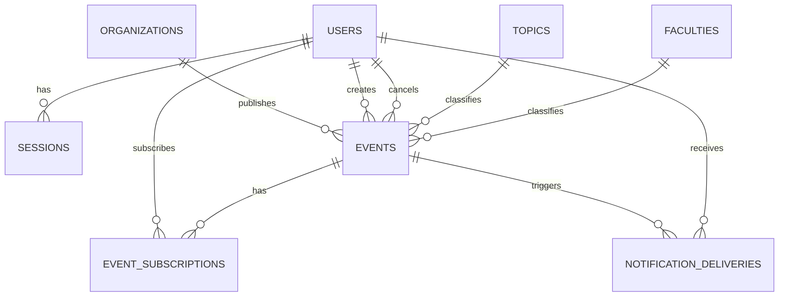
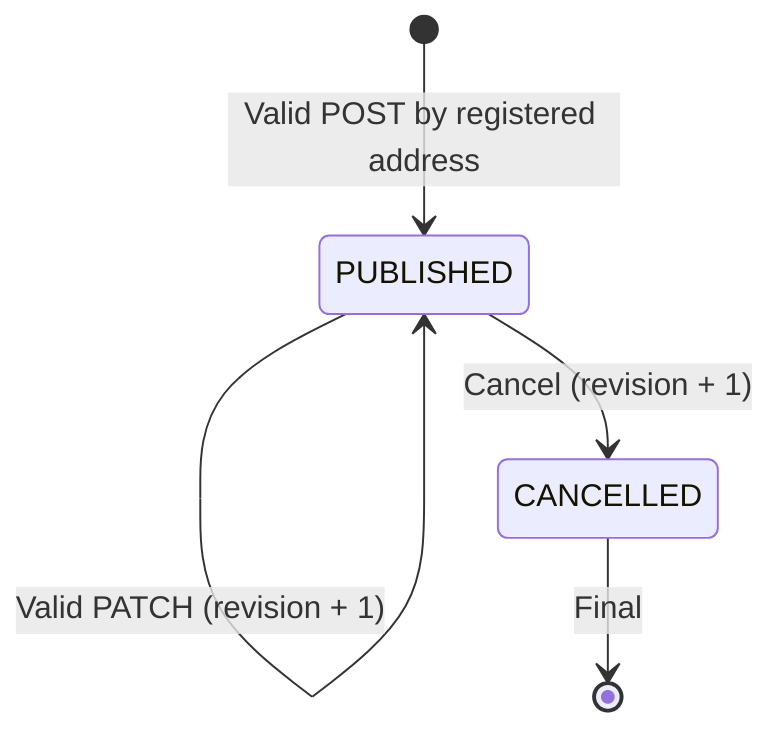

# AlmaMater — MVP Data Model and Persistence Contract

**Practice:** 4.3 — Technical contracts  
**Status:** MVP contract aligned with the requirements digest (D-01…D-10, A-01…A-18); not implemented beyond the walking-skeleton baseline migration `0001`  
**Date:** 2026-10-28  
**Related:** [`api-contracts.md`](api-contracts.md), [`requirements.md`](requirements.md), [`analysis/requirements-digest.md`](analysis/requirements-digest.md), [`user-stories/`](user-stories/), ADRs in [`../raw_research_output/adr/`](../raw_research_output/adr/)

## 1. Purpose and scope

This document specifies the logical relational data model for the AlmaMater MVP: signed-in NaUKMA members and their server-side sessions, student organisations with their single registered address, structured events, fixed topic/faculty dictionaries, event subscriptions and the notification outbox. It covers the canonical `docs/requirements.md` scope (39 stories, including US-45a/b/c and US-55a/b) and the decisions in `analysis/requirements-digest.md`.

It deliberately does **not** model draft persistence (US-10), student applications/RSVP, moderation queues, automated social posting, reminders (US-30), analytics, user profiles, event requirements/prerequisites (US-18), language (US-24) or capacity (US-31). These are outside the MVP.

Stack: PostgreSQL + SQLAlchemy + Alembic (ADR-004), FastAPI (ADR-003), Office 365 sign-in with server-side sessions (ADR-005), PostgreSQL outbox + worker for email (ADR-007).

### 1.1 Contract decisions

Contract-level decisions are numbered **C-xx** so they never collide with the digest's product-owner decisions **D-xx** and assumptions **A-xx**.

| ID | Contract decision | Source |
| --- | --- | --- |
| C-01 | Every reader and organiser authenticates through NaUKMA Office 365; only verified `@ukma.edu.ua` accounts get a session. No local registration or passwords. All event reads require a session. | D-06, D-08, A-01, A-03, A-16, ADR-005 |
| C-02 | Publishing rights come only from the organisation register: each organisation has exactly one registered address, each address belongs to exactly one organisation. A user manages an organisation iff the user's verified email equals that organisation's `registered_email`. | D-03, D-07, A-02, A-05 |
| C-03 | Events are created and published in one successful request. Stored statuses are `PUBLISHED` and `CANCELLED`; there is no `DRAFT`. "Past" is derived from `starts_at`, not stored. | A-04, A-13 |
| C-04 | Cancellation is a final status change, not deletion. Cancelled and past events leave the catalog but stay readable at their stable URL. Neither can be edited, cancelled again or subscribed to. | A-13, A-14, US-45a AC3 |
| C-05 | Each event has one topic, one faculty, one format and one of three participation methods. | A-07, US-25 |
| C-06 | IDs are UUIDs; instants are stored as UTC `TIMESTAMPTZ`; calendar dates are interpreted in `Europe/Kyiv`. | A-08, ADR-004 |
| C-07 | Every committed edit or cancellation increments `events.revision`. Clients send the revision they edited, so concurrent edits by several holders of the shared mailbox are detected instead of silently overwritten. | NFR-11, A-05 |
| C-08 | Notification intent is written to `notification_deliveries` in the same transaction as the event change; a worker sends it later. A mail failure never undoes the event change. | D-09, D-10, NFR-20, NFR-21, ADR-007 |

## 2. Entity relationships

There is no foreign key between `users` and `organizations`: the link is the equality of the normalised emails `users.email = organizations.registered_email` (C-02). The organisation's mailbox signs in like any other member (D-06), and the first sign-in creates its `users` row.

## 3. Tables and fields

Notation: **PK** = primary key; **FK** = foreign key; **UQ** = unique; **NN** = `NOT NULL`. Types target **PostgreSQL**. SQLAlchemy models and Alembic migrations must preserve these constraints. Nullable means the value may be absent, **not** that invalid supplied values are permitted. All foreign keys are `ON DELETE RESTRICT` unless stated otherwise.

### 3.1 `users`

| Column | Type | Constraints | Meaning |
| --- | --- | --- | --- |
| `id` | UUID | PK, NN | Internal immutable user ID. |
| `identity_provider` | VARCHAR(64) | NN | Identifier of the configured identity provider (the NaUKMA Office 365 tenant). |
| `provider_subject` | VARCHAR(255) | NN | Stable authenticated subject from that provider. |
| `email` | VARCHAR(320) | NN, UQ | Verified `@ukma.edu.ua` address, stored lowercase; used for notifications (US-45b AC1) and for the C-02 organisation match. |
| `created_at` | TIMESTAMPTZ | NN | First successful sign-in (creates the member record, A-16). |
| `last_login_at` | TIMESTAMPTZ | NN | Most recent successful sign-in. |

- `UNIQUE(identity_provider, provider_subject)`: identity is not derived from the email alone.
- `email` is accepted only when the provider marks it verified **and** it belongs to the `ukma.edu.ua` domain (D-08). An email string submitted by the client is never proof of identity.
- No password, provider token or role flag is stored here.

### 3.2 `sessions`

Server-side member sessions (ADR-005). A browser cookie carries an opaque random token; only its hash is stored.

| Column | Type | Constraints | Meaning |
| --- | --- | --- | --- |
| `id` | UUID | PK, NN | Session record ID. |
| `token_hash` | CHAR(64) | NN, UQ | SHA-256 hex of the opaque session token. |
| `user_id` | UUID | FK → `users.id` `ON DELETE CASCADE`, NN | Session owner. |
| `created_at` | TIMESTAMPTZ | NN | Sign-in instant. |
| `last_seen_at` | TIMESTAMPTZ | NN | Last authenticated request; drives the inactivity timeout (A-01). |
| `expires_at` | TIMESTAMPTZ | NN | Absolute expiry. |
| `revoked_at` | TIMESTAMPTZ | NULL | Set on sign-out. |

- A session is valid iff `revoked_at IS NULL`, `expires_at > now` and the inactivity timeout has not elapsed since `last_seen_at`. Timeout values are configuration, not schema.
- The CSRF token is derived from the session token with a server secret (HMAC); it is not stored.
- Index `sessions(user_id)`.

### 3.3 `organizations`

| Column | Type | Constraints | Meaning |
| --- | --- | --- | --- |
| `id` | UUID | PK, NN | Organisation ID. |
| `name` | VARCHAR(160) | NN | Display name. |
| `slug` | VARCHAR(100) | NN, UQ | Stable machine-readable identifier. |
| `registered_email` | VARCHAR(320) | NN, UQ | The organisation's single registered NaUKMA Office 365 address, stored lowercase (D-03, D-06). |

- The register is compiled and verified by the platform team and loaded as seed data; later changes are made by hand (D-07, A-02). There is no API to create organisations or change addresses.
- `UNIQUE(registered_email)` enforces "each address belongs to exactly one organisation"; one column per row enforces "one address per organisation".
- `registered_email` is never returned by the API.

### 3.4 `topics` and `faculties`

Both tables have the same columns:

| Column | Type | Constraints | Meaning |
| --- | --- | --- | --- |
| `id` | UUID | PK, NN | Dictionary ID. |
| `code` | VARCHAR(64) | NN, UQ | Stable machine-readable value. |
| `name` | VARCHAR(160) | NN | Human-readable label shown in the UI. |

Fixed, seeded lists (A-07; the faculty list = NaUKMA faculties). The team must provide the real values; do not invent them. Events reference only existing IDs. Changing a label does not change its ID.

### 3.5 `events`

| Column | Type | Constraints | Meaning / story |
| --- | --- | --- | --- |
| `id` | UUID | PK, NN | Stable event URL identifier (US-43). |
| `organization_id` | UUID | FK → `organizations.id`, NN | Publishing organisation, derived from the signed-in registered address (US-03, C-02). |
| `created_by_user_id` | UUID | FK → `users.id`, NN | Account that published the event. |
| `status` | VARCHAR(16) | NN, `CHECK IN ('PUBLISHED','CANCELLED')` | Publication/cancellation state. |
| `revision` | INTEGER | NN, `DEFAULT 1`, `CHECK >= 1` | Incremented by every committed edit or cancellation (C-07, C-08). |
| `title` | VARCHAR(160) | NN | Event name (US-12a). |
| `description` | TEXT | NN | Event description (US-12a). |
| `starts_at` | TIMESTAMPTZ | NN | Start date and time (US-12b). |
| `speaker_name` | VARCHAR(160) | NULL | Speaker, if provided (US-12c). |
| `topic_id` | UUID | FK → `topics.id`, NN | One predefined topic (US-15a). |
| `faculty_id` | UUID | FK → `faculties.id`, NN | One predefined faculty (US-15b). |
| `intended_audience` | TEXT | NULL | Audience description, if provided (US-16a). |
| `newcomers_welcome` | BOOLEAN | NULL | `true`, `false` or not specified (US-16b). |
| `format` | VARCHAR(16) | NN, `CHECK IN ('ONLINE','IN_PERSON')` | Event format (US-17a). |
| `venue` | VARCHAR(500) | NULL | Physical venue when `IN_PERSON` (US-17b). |
| `meeting_url` | TEXT | NULL | HTTPS link when `ONLINE` (US-17b). |
| `duration_minutes` | INTEGER | NULL, `CHECK > 0` | Expected duration in minutes, if provided (US-17c, A-06). |
| `registration_deadline` | TIMESTAMPTZ | NULL | Registration/application deadline, if provided (US-21). |
| `participation_method` | VARCHAR(24) | NN, allowed values below | One method (US-25). |
| `google_form_url` | TEXT | NULL | External Google Form link (US-26, US-52a). |
| `contact_details` | TEXT | NULL | Free-text organiser contact details (US-26, US-52b, A-10). |
| `attendance_instructions` | TEXT | NULL | Open-attendance instructions (US-26, US-52c). |
| `published_at` | TIMESTAMPTZ | NN | Successful publication instant (US-39). |
| `updated_at` | TIMESTAMPTZ | NN | Last committed edit or cancellation. |
| `cancelled_at` | TIMESTAMPTZ | NULL | Cancellation instant, if cancelled. |
| `cancelled_by_user_id` | UUID | FK → `users.id`, NULL | Account that cancelled. |

**Allowed participation methods:** `GOOGLE_FORM`, `DIRECT_CONTACT`, `OPEN_ATTENDANCE`.

#### Conditional integrity constraints

Enforced by server validation and, where expressible, by DB `CHECK` constraints:

1. `format = 'ONLINE'` requires a non-empty `meeting_url` and `venue IS NULL`; `format = 'IN_PERSON'` requires a non-empty `venue` and `meeting_url IS NULL` (D-01, BR-16).
2. `GOOGLE_FORM` requires a non-empty `google_form_url`; `DIRECT_CONTACT` requires non-empty `contact_details`; `OPEN_ATTENDANCE` requires non-empty `attendance_instructions`. The other two method fields are null (D-05, BR-22, BR-23).
3. `registration_deadline`, if present, is not after `starts_at` (`registration_deadline <= starts_at`, A-10). It is optional for every method.
4. `PUBLISHED` requires `cancelled_at IS NULL AND cancelled_by_user_id IS NULL`; `CANCELLED` requires both non-null.
5. At publication and on every edit, `starts_at` must be in the future (A-08). Validation rule, not a DB constraint.
6. Required text fields are trimmed and must not be blank. Optional fields are never filled with invented values (BR-43).
7. `meeting_url` and `google_form_url` must be well-formed `https://` URLs. Domain and reachability are not checked (A-09). Any other scheme (`http:`, `javascript:`, `file:` …) is rejected (NFR-05).
8. Text is stored as UTF-8 without loss (NFR-14).

#### Unique keys, deletion and indexing

- **Do not** add `UNIQUE(title)` or `UNIQUE(title, starts_at)`: separate events may legitimately share a name and time.
- Events are never physically deleted in the MVP.
- Indexes: `events(status, starts_at)` for the catalog; FK indexes on `organization_id`, `topic_id`, `faculty_id`.
- Catalog order is ascending `(starts_at, id)` (D-04).

### 3.6 `event_subscriptions`

| Column | Type | Constraints | Meaning |
| --- | --- | --- | --- |
| `user_id` | UUID | PK part, FK → `users.id`, NN | Subscribed member. |
| `event_id` | UUID | PK part, FK → `events.id`, NN | Event subscribed to. |
| `created_at` | TIMESTAMPTZ | NN | Subscription instant. |

- `PRIMARY KEY(user_id, event_id)`: one subscription per member and event (US-45a).
- Rows are created only for `PUBLISHED` events whose `starts_at` is in the future (US-45a AC3).
- A subscription ends when the member unsubscribes (row deleted, US-45a AC2) or when the event is cancelled (rows deleted in the cancellation transaction after the cancellation deliveries are written, A-17). Rows of past events are inert: past events cannot be edited or cancelled, so they never trigger anything, and no scheduler is needed.
- Subscriptions are visible only to the member and the platform; no API exposes them to organisers (NFR-19).
- Index `event_subscriptions(event_id)` for recipient snapshots.

### 3.7 `notification_deliveries`

The outbox from ADR-007: one row per email to send.

| Column | Type | Constraints | Meaning |
| --- | --- | --- | --- |
| `id` | UUID | PK, NN | Delivery ID. |
| `event_id` | UUID | FK → `events.id`, NN | Event the email is about. |
| `event_revision` | INTEGER | NN | `events.revision` produced by the triggering change. |
| `kind` | VARCHAR(16) | NN, `CHECK IN ('CHANGED','CANCELLED')` | Change email (US-45b) or cancellation email (US-45c). |
| `user_id` | UUID | FK → `users.id`, NN | Recipient member. |
| `recipient_email` | VARCHAR(320) | NN | Recipient address snapshot at commit time. |
| `status` | VARCHAR(16) | NN, `CHECK IN ('PENDING','SENDING','SENT','FAILED')` | Delivery state. |
| `attempts` | INTEGER | NN, `DEFAULT 0` | Send attempts made. |
| `next_attempt_at` | TIMESTAMPTZ | NN | Earliest next attempt (retry backoff). |
| `claimed_until` | TIMESTAMPTZ | NULL | Expiring worker claim while `SENDING`, for crash recovery. |
| `last_error` | TEXT | NULL | Last provider error, for diagnostics. |
| `created_at` | TIMESTAMPTZ | NN | Commit instant of the triggering change. |
| `sent_at` | TIMESTAMPTZ | NULL | Provider acceptance instant. |

- `UNIQUE(event_id, event_revision, kind, user_id)`: a retried save or repeated cancel can never queue a second email for the same change (NFR-21).
- Index `notification_deliveries(status, next_attempt_at)` for the worker.
- States: `PENDING → SENDING → SENT`; `SENDING → PENDING` on a transient error or an expired claim; `→ FAILED` when the retry limit is reached. The network call happens outside the claiming transaction.
- One email per subscriber per committed change. The fixed Ukrainian template contains the event title, what happened, the current date and time, and the event link (A-18). The link still requires sign-in.

#### Trigger rules (D-10)

| Committed operation | Deliveries written |
| --- | --- |
| Edit that changes `starts_at` (date or start time), `format`, `venue`, `meeting_url`, `participation_method`, or the field of the resulting method (`google_form_url` / `contact_details` / `attendance_instructions`) | One `CHANGED` row per current subscriber |
| Edit that changes only other fields (title, description, speaker, topic, faculty, audience, newcomers, duration, registration deadline) | None (US-45b AC3) |
| Edit with no effective change (normalised old = new) | None; `revision` is not incremented |
| First cancellation (`PUBLISHED → CANCELLED`) | One `CANCELLED` row per current subscriber |
| Rejected edit/cancel, rollback, repeated cancellation | None (US-45b AC2, US-45c AC2) |

Values are compared after the same normalisation as validation (trimmed text, UTC instants).

## 4. Event lifecycle and visibility

"Past" (`starts_at <= now`) is derived, not stored (C-03).

| Operation | Allowed when | Persistence rule |
| --- | --- | --- |
| Publish | Caller is a registered organisation address; complete valid input | Insert a `PUBLISHED` event with `revision = 1` atomically. |
| Edit | Caller manages the owning organisation; `PUBLISHED`; not past; submitted revision = current | Validate the merged record; update atomically; `revision + 1`; write `CHANGED` deliveries if D-10 applies. ID and URL are unchanged. |
| Cancel | Caller manages the owning organisation; `PUBLISHED`; not past | Set `CANCELLED`, `cancelled_at`, `cancelled_by_user_id`; `revision + 1`; write `CANCELLED` deliveries; delete subscriptions. All in one transaction. |
| Cancel again | Not allowed | `409 EVENT_ALREADY_CANCELLED`; no change, no email. |
| Edit/cancel a cancelled or past event | Not allowed | `409 EVENT_NOT_EDITABLE`; no change. |
| Subscribe | Signed-in member; `PUBLISHED`; not past | Insert the subscription row if absent. |
| Browse | Signed-in member | Only `PUBLISHED` events with `starts_at > now` that match the filters. |
| Open stable link | Signed-in member | Any known event resolves; cancelled and past events are marked as such. Unknown ID → `404`. |

## 5. Field requirements matrix

Fixed by the product owner (D-01, D-05, A-06):

| Field | Required at publication and after every edit |
| --- | --- |
| `title`, `description` | Required |
| `startsAt` (date + start time) | Required, in the future |
| `topicId`, `facultyId` | Required, existing dictionary IDs |
| `format` | Required |
| `venue` | Required iff `format = IN_PERSON`; otherwise null |
| `meetingUrl` | Required iff `format = ONLINE`; otherwise null |
| `participationMethod` | Required |
| `googleFormUrl` / `contactDetails` / `attendanceInstructions` | Required for the chosen method only; the other two null |
| `speakerName`, `intendedAudience`, `newcomersWelcome`, `durationMinutes`, `registrationDeadline` | Optional |
| Organisation, creator | Assigned by the server, never supplied by the client |

Changing requiredness changes DB nullability and API validation together.

## 6. Cross-layer invariants and traceability

| User stories | Persistent data / invariant | API responsibility |
| --- | --- | --- |
| US-01, US-55a | `users`, `sessions`; only verified `@ukma.edu.ua` accounts | Sign-in, session cookie, sign-out |
| US-55b, US-43, US-49 | Every event read needs a valid session | `401` without session; `returnTo` survives sign-in |
| US-02, US-03, US-07 | `organizations.registered_email` match (C-02) | `/auth/me` returns the managed organisation; mutations re-check it |
| US-12a–c, US-13, US-15a–b, US-16a–b, US-17a–c, US-21, US-36 | `events` fields, CHECKs, dictionary FKs | Validate the complete event; return all field errors at once |
| US-25, US-26, US-52a–c | Method enum and exclusive method fields | Return only the chosen method's data |
| US-39, US-41, US-43 | `status`, `published_at`, UUID | Atomic publication; confirmation with a stable `eventUrl` |
| US-44a, US-44b, US-47 | Immutable ID, `status`, `revision`, cancellation metadata | Ownership check, lifecycle rules, optimistic concurrency |
| US-45a | `event_subscriptions` | Subscribe/unsubscribe; `subscribed` flag on details |
| US-45b, US-45c | `notification_deliveries`, trigger rules §3.7 | Deliveries written in the edit/cancel transaction |
| US-49, US-50a–d, US-51 | Topic/faculty/organisation refs, `starts_at` | Multi-select filters, date range, details |

## 7. Explicit non-requirements

- No `registrations`, `rsvps`, `attendees`, `drafts`, `moderation_queue`, `social_posts`, `analytics`, `reminders` or `event_images` tables in the MVP.
- Students follow an external Google Form, contact the organiser, or read open-attendance instructions; the application does not record participation.
- No organisation self-registration, no admin UI, no student self-publishing.
- No organiser access to subscriber lists.

## 8. Open inputs before implementation

- Real seed data: the organisation register with registered addresses, the topic list, the faculty list (D-07, A-07). Do not invent values.
- Office 365 app registration for the NaUKMA tenant and an authorised mail transport for the worker (ADR-005, ADR-007).
- Session lifetime and inactivity-timeout values; retry limit and backoff for deliveries.
