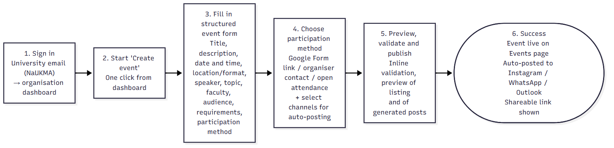
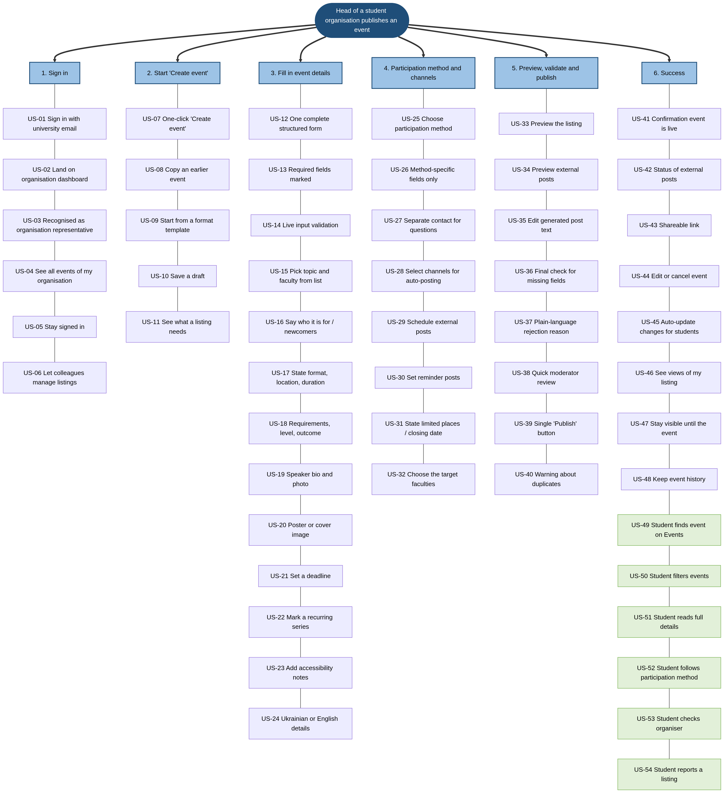

# AlmaMater Project Requirements Specification

## 1. User Journey

The target Happy Path follows the head of a NaUKMA student organisation publishing an event.

1. **Sign in.** The organiser signs in with a NaUKMA university email. The system verifies university membership and the organisation role, then opens the organisation dashboard.
2. **Start “Create event.”** The organiser selects the prominent creation action. The system opens an empty structured event form.
3. **Fill in event details.** The organiser enters the title, description, date and time, location or online link, speaker, topic, faculty, target audience, requirements, language, and optional capacity. The system marks required fields and validates supported dates, times, and links.
4. **Choose participation method and channels.** The organiser selects a Google Form, direct organiser contact, or open attendance and selects connected external channels. The system shows the fields relevant to the chosen participation method.
5. **Preview, validate, and publish.** The organiser reviews the listing and generated external posts, then selects “Publish.” The system performs final validation and automated content checks, involving a moderator only for edge cases.
6. **Success.** The system publishes the event on the `Events` page, posts it to the selected external channels, and shows a confirmation with a shareable listing link.

## 2. Story Map

The complete story map arranges the source story pool across the six stages of the organiser’s publishing journey. Scope decisions for these stories are specified separately in the next section.

## 3. Scope

The MVP scope follows the In Scope/Out of Scope decisions in `3.3_story_mapping_scope.md`. In-scope source stories are decomposed into atomic stories using the decomposition approach in `3.4_mvp_story_refinement.md`.

### In Scope (MVP)

| Journey step | ID | Source | Capability |
|---|---|---|---|
| 1. Sign in | US-01 | US-01 | Sign in using a NaUKMA university email |
| 1. Sign in | US-02 | US-02 | Land on the organisation dashboard |
| 1. Sign in | US-03 | US-03 | Link the organiser account to the represented organisation |
| 2. Start “Create event” | US-07 | US-07 | Start event creation from a clearly labelled action |
| 3. Fill in event details | US-12a | US-12 | Enter an event title and description |
| 3. Fill in event details | US-12b | US-12 | Specify the event date and start time |
| 3. Fill in event details | US-12c | US-12 | Enter the speaker’s name |
| 3. Fill in event details | US-13 | US-13 | Distinguish required fields from optional fields |
| 3. Fill in event details | US-15a | US-15 | Choose a topic from a predefined list |
| 3. Fill in event details | US-15b | US-15 | Choose a faculty from a predefined list |
| 3. Fill in event details | US-16a | US-16 | Describe the intended audience |
| 3. Fill in event details | US-16b | US-16 | Indicate whether newcomers are welcome |
| 3. Fill in event details | US-17a | US-17 | Specify whether the event is online or in person |
| 3. Fill in event details | US-17b | US-17 | Provide a venue or online meeting link |
| 3. Fill in event details | US-17c | US-17 | Specify the expected duration |
| 3. Fill in event details | US-21 | US-21 | Set an application or registration deadline |
| 4. Choose participation method and channels | US-25 | US-25 | Select one participation method |
| 4. Choose participation method and channels | US-26 | US-26 | Show only participation fields relevant to the selected method |
| 5. Preview, validate, and publish | US-36 | US-36 | Report missing or invalid fields before publication |
| 5. Preview, validate, and publish | US-39 | US-39 | Publish a completed event using a clear action |
| 6. Success | US-41 | US-41 | Confirm that the event is live on the `Events` page |
| 6. Success | US-43 | US-43 | Provide a shareable event link |
| 6. Success | US-44a | US-44 | Edit a published event |
| 6. Success | US-44b | US-44 | Cancel a published event |
| 6. Success | US-47 | US-47 | Keep an event discoverable until its scheduled date |
| 6. Success | US-49 | US-49 | Browse events on the `Events` page |
| 6. Success | US-50a | US-50 | Filter events by topic |
| 6. Success | US-50b | US-50 | Filter events by faculty |
| 6. Success | US-50c | US-50 | Filter events by date |
| 6. Success | US-50d | US-50 | Filter events by organisation |
| 6. Success | US-51 | US-51 | Open an event’s full details |
| 6. Success | US-52a | US-52 | Open the selected Google Form |
| 6. Success | US-52b | US-52 | Access organiser contact details |
| 6. Success | US-52c | US-52 | Read open-attendance instructions |

### Out of Scope

| Journey step | ID | Capability |
|---|---|---|
| 1. Sign in | US-04 | See all upcoming and past events of the organisation |
| 1. Sign in | US-05 | Stay signed in on the device |
| 1. Sign in | US-06 | Let other organisation members manage listings |
| 2. Start “Create event” | US-08 | Copy an earlier event |
| 2. Start “Create event” | US-09 | Start from an event-format template |
| 2. Start “Create event” | US-10 | Save an unfinished listing as a draft |
| 2. Start “Create event” | US-11 | Show pre-creation listing guidance |
| 3. Fill in event details | US-14 | Validate input as the organiser types |
| 3. Fill in event details | US-18 | Capture requirements, participant level, and expected outcome |
| 3. Fill in event details | US-19 | Add a speaker biography and photo |
| 3. Fill in event details | US-20 | Attach a poster or cover image |
| 3. Fill in event details | US-22 | Mark an event as part of a recurring series |
| 3. Fill in event details | US-23 | Add dedicated accessibility notes |
| 3. Fill in event details | US-24 | Provide dedicated Ukrainian and English details |
| 4. Choose participation method and channels | US-27 | Provide separate contact details for questions |
| 4. Choose participation method and channels | US-28 | Select external channels for automatic posting |
| 4. Choose participation method and channels | US-29 | Schedule external posts |
| 4. Choose participation method and channels | US-30 | Schedule reminder posts |
| 4. Choose participation method and channels | US-31 | State limited places or a closing date as a separate capability |
| 4. Choose participation method and channels | US-32 | Restrict visibility to selected faculties |
| 5. Preview, validate, and publish | US-33 | Preview the student-facing listing |
| 5. Preview, validate, and publish | US-34 | Preview generated external posts |
| 5. Preview, validate, and publish | US-35 | Edit generated external-post text |
| 5. Preview, validate, and publish | US-37 | Explain moderation rejection or flagging reasons |
| 5. Preview, validate, and publish | US-38 | Provide moderator review for flagged listings |
| 5. Preview, validate, and publish | US-40 | Warn about possible duplicate events |
| 6. Success | US-42 | Report the status of external posts |
| 6. Success | US-45 | Automatically notify students about event changes |
| 6. Success | US-46 | Show listing-view analytics |
| 6. Success | US-48 | Keep completed events in organisation history |
| 6. Success | US-53 | Show an organiser profile and its other events |
| 6. Success | US-54 | Let students report a listing |

## 4. MVP User Story Specifications

| ID | User Story | Journey Step | Dependencies |
|---|---|---|---|
| US-01 | As an organiser, I want to sign in using my NaUKMA university email, so that I can access the platform as a university member. | 1. Sign in | None |
| US-02 | As an organiser, I want to land on my organisation’s dashboard after signing in, so that I can reach event creation without searching for it. | 1. Sign in | US-01, US-03 |
| US-03 | As an organiser, I want my account linked to the organisation I represent, so that my event is attributed to the correct organisation. | 1. Sign in | US-01 |
| US-07 | As an organiser, I want to start creating an event from a clearly labelled action, so that I can publish an opportunity without searching for the form. | 2. Start “Create event” | US-02, US-03 |
| US-12a | As an organiser, I want to enter an event title and description, so that students understand what the event is about. | 3. Fill in event details | US-07 |
| US-12b | As an organiser, I want to specify the event date and start time, so that students know when it takes place. | 3. Fill in event details | US-07 |
| US-12c | As an organiser, I want to enter the speaker’s name, so that students know who will present. | 3. Fill in event details | US-07 |
| US-13 | As an organiser, I want required fields to be marked, so that I know what must be completed before publication. | 3. Fill in event details | US-07 |
| US-15a | As an organiser, I want to choose an event topic from a predefined list, so that students can find it using a topic filter. | 3. Fill in event details | US-07 |
| US-15b | As an organiser, I want to choose a relevant faculty from a predefined list, so that students can find it using a faculty filter. | 3. Fill in event details | US-07 |
| US-16a | As an organiser, I want to describe the intended audience, so that students can judge whether the event is relevant to them. | 3. Fill in event details | US-07 |
| US-16b | As an organiser, I want to indicate whether newcomers are welcome, so that new students know whether they can attend. | 3. Fill in event details | US-07 |
| US-17a | As an organiser, I want to specify whether the event is online or in person, so that students understand its format. | 3. Fill in event details | US-07 |
| US-17b | As an organiser, I want to provide the venue or online meeting link, so that students know where to attend. | 3. Fill in event details | US-17a |
| US-17c | As an organiser, I want to specify the expected duration, so that students can assess the time commitment. | 3. Fill in event details | US-07 |
| US-21 | As an organiser, I want to set an application or registration deadline, so that students know how long they have to act. | 3. Fill in event details | US-07 |
| US-25 | As an organiser, I want to select one participation method—Google Form, direct contact, or open attendance—so that students know how to join. | 4. Choose participation method and channels | US-07 |
| US-26 | As an organiser, I want to see only the participation fields relevant to my chosen method, so that I can complete the form without irrelevant inputs. | 4. Choose participation method and channels | US-25 |
| US-36 | As an organiser, I want to receive a list of missing or invalid fields before publication, so that I can correct errors. | 5. Preview, validate, and publish | US-12a, US-12b, US-12c, US-13, US-15a, US-15b, US-16a, US-16b, US-17a, US-17b, US-17c, US-21, US-25, US-26 |
| US-39 | As an organiser, I want to publish a completed event using a clear action, so that it becomes visible in the catalog. | 5. Preview, validate, and publish | US-03, US-36 |
| US-41 | As an organiser, I want confirmation that my event is live on the `Events` page, so that I know students can discover it. | 6. Success | US-39 |
| US-43 | As an organiser, I want a shareable event link, so that I can distribute the listing through existing channels. | 6. Success | US-39 |
| US-44a | As an organiser, I want to edit my published event, so that I can keep its details accurate. | 6. Success | US-03, US-39 |
| US-44b | As an organiser, I want to cancel my published event, so that students are not misled about whether it will take place. | 6. Success | US-03, US-39 |
| US-47 | As an organiser, I want the event to remain discoverable until its scheduled date, so that students can find it after the initial announcement. | 6. Success | US-39 |
| US-49 | As a student, I want to browse events on the `Events` page, so that I can discover activities outside the organiser’s social channels. | 6. Success | US-39 |
| US-50a | As a student, I want to filter events by topic, so that I can find activities matching my interests. | 6. Success | US-15a, US-49 |
| US-50b | As a student, I want to filter events by faculty, so that I can find activities relevant to my studies. | 6. Success | US-15b, US-49 |
| US-50c | As a student, I want to filter events by date, so that I can find activities that fit my schedule. | 6. Success | US-12b, US-49 |
| US-50d | As a student, I want to filter events by organisation, so that I can find activities from a particular organiser. | 6. Success | US-03, US-49 |
| US-51 | As a student, I want to open an event’s full details, so that I can decide whether it suits me. | 6. Success | US-39, US-49 |
| US-52a | As a student, I want to open the provided Google Form when that method is selected, so that I can register externally. | 6. Success | US-25, US-26, US-51 |
| US-52b | As a student, I want to access the organiser’s contact details when direct contact is selected, so that I can ask to participate. | 6. Success | US-25, US-26, US-51 |
| US-52c | As a student, I want to see instructions for open attendance when that method is selected, so that I know how to attend without registration. | 6. Success | US-25, US-26, US-51 |

## 5. Acceptance Criteria

The precise required-field matrix and accepted value sets are not specified at this stage. References below to required or valid values therefore mean values configured as such by the implementation.

### US-01 — University sign-in

- **Given** an organiser has an eligible NaUKMA university email and valid credentials, **when** sign-in succeeds, **then** the platform creates an authenticated university session.
- **Given** authentication does not succeed, **when** the person attempts to sign in, **then** access is denied and no authenticated session is created.

### US-02 — Organisation dashboard

- **Given** an authenticated organiser is linked to an organisation, **when** sign-in completes, **then** the organiser lands on that organisation’s dashboard.
- **Given** a user is not linked to an organisation, **when** sign-in completes, **then** the platform does not present that user with another organisation’s dashboard.

### US-03 — Organisation attribution

- **Given** an organiser is authorised to represent an organisation, **when** the organiser starts an event, **then** the event is associated with that organisation.
- **Given** a university member has no publishing rights for an organisation, **when** the member attempts to publish for it, **then** publication under that organisation is prevented.

### US-07 — Start event creation

- **Given** an authorised organiser is on the organisation dashboard, **when** the organiser selects “Create event,” **then** an event-creation form opens ready for input.
- **Given** a user lacks organisational publishing permission, **when** the user attempts to open the creation workflow, **then** access is denied.

### US-12a — Title and description

- **Given** an organiser enters a title and description, **when** the event is published, **then** both saved values appear accurately on the event details page.
- **Given** either field is configured as required and is empty, **when** publication is attempted, **then** publication is blocked and the missing field is identified.

### US-12b — Date and start time

- **Given** an organiser enters a supported date and start time, **when** the event is published, **then** the chosen schedule appears accurately on the listing.
- **Given** a supplied date or time is invalid, **when** publication is attempted, **then** publication is blocked and the invalid value is identified.

### US-12c — Speaker name

- **Given** an organiser enters a speaker name, **when** the event is published, **then** the saved name appears accurately on the event details page.
- **Given** the speaker field is optional and empty, **when** an otherwise valid event is published, **then** the system neither invents a speaker nor blocks publication for that field.

### US-13 — Required-field marking

- **Given** the organiser opens the event form, **when** the form is displayed, **then** every configured mandatory input is distinguishable from optional inputs.
- **Given** a field is optional under the current selections, **when** it is left empty, **then** it is not presented as mandatory.

### US-15a — Event topic

- **Given** the form offers predefined topics, **when** an organiser selects one and publishes the event, **then** the selected topic is stored, displayed, and usable by the topic filter.
- **Given** a submitted topic is not among the predefined options, **when** publication is attempted, **then** the value is rejected.

### US-15b — Event faculty

- **Given** the form offers predefined faculties, **when** an organiser selects one and publishes the event, **then** the selected faculty is stored, displayed, and usable by the faculty filter.
- **Given** a submitted faculty is not among the predefined options, **when** publication is attempted, **then** the value is rejected.

### US-16a — Intended audience

- **Given** an organiser describes the intended audience, **when** the event is published, **then** the description appears accurately in the event details.
- **Given** the audience field is optional and empty, **when** an otherwise valid event is published, **then** the system does not invent an audience value.

### US-16b — Newcomer eligibility

- **Given** an organiser specifies whether newcomers are welcome, **when** the event is published, **then** the selected value is communicated accurately in the event details.
- **Given** no eligibility choice has been made and the choice is configured as required, **when** publication is attempted, **then** publication is blocked and the missing choice is identified.

### US-17a — Event format

- **Given** the form offers online and in-person formats, **when** the organiser selects one and publishes, **then** the selected format appears accurately on the listing.
- **Given** the organiser changes the format before publication, **when** the event is published, **then** only the final selection is presented.

### US-17b — Venue or meeting link

- **Given** the organiser supplies a venue for an in-person event or a supported meeting link for an online event, **when** the event is published, **then** the applicable attendance location is displayed.
- **Given** a supplied online link is invalid, **when** publication is attempted, **then** publication is blocked and the link is identified for correction.

### US-17c — Expected duration

- **Given** an organiser supplies a valid positive duration, **when** the event is published, **then** the duration appears accurately in the details.
- **Given** a supplied duration is zero, negative, or unsupported, **when** publication is attempted, **then** the value is rejected.

### US-21 — Registration deadline

- **Given** an organiser sets a supported application or registration deadline, **when** the event is published, **then** students can see that deadline.
- **Given** a supplied deadline is invalid, **when** publication is attempted, **then** publication is blocked and the deadline is identified for correction.

### US-25 — Participation method

- **Given** an organiser selects Google Form, direct contact, or open attendance, **when** the selection is saved, **then** exactly one participation method is associated with the event.
- **Given** the organiser switches methods, **when** the form updates, **then** only the latest method remains active.

### US-26 — Method-specific fields

- **Given** an organiser selects a participation method, **when** the participation section updates, **then** inputs relevant to that method are shown and irrelevant inputs are not required.
- **Given** the organiser changes the method, **when** the section updates, **then** inputs and validation correspond to the new method.

### US-36 — Final validation

- **Given** all configured mandatory fields contain valid values, **when** the organiser attempts publication, **then** validation passes without missing-field errors.
- **Given** fields are missing or invalid, **when** publication is attempted, **then** the event remains unpublished and every detected issue is identified without discarding other entered values.

### US-39 — Publish event

- **Given** an authorised organiser has an event that passes validation, **when** the organiser selects “Publish,” **then** the event becomes visible in the `Events` catalog under the correct organisation.
- **Given** validation or authorisation fails, **when** publication is attempted, **then** the event remains unpublished.

### US-41 — Publication confirmation

- **Given** publication succeeds, **when** processing completes, **then** the interface confirms that the event is live and provides a way to view it.
- **Given** publication fails or is blocked, **when** processing completes, **then** the interface does not show a false success confirmation.

### US-43 — Shareable event link

- **Given** an event has been published, **when** its confirmation or details page opens, **then** a stable URL is available and resolves to that event.
- **Given** an event has not been published, **when** the organiser looks for its public URL, **then** the platform does not present it as a public listing.

### US-44a — Edit a published event

- **Given** an authorised organiser manages a published event, **when** the organiser saves valid changes, **then** the updated details appear at the existing event URL.
- **Given** an organiser does not manage the event or submits invalid changes, **when** saving is attempted, **then** the change is rejected and the published event remains unchanged.

### US-44b — Cancel a published event

- **Given** an authorised organiser manages an active published event, **when** the organiser cancels it, **then** students are not presented with it as an active upcoming event.
- **Given** an organiser is unauthorised or the event is already cancelled, **when** cancellation is attempted, **then** no invalid state change occurs.

### US-47 — Persistent discoverability

- **Given** an event is published, active, and scheduled for a future date, **when** a student visits the catalog before that date, **then** the event remains discoverable.
- **Given** an event is unpublished or cancelled, **when** a student browses active upcoming events, **then** it is not presented as available to attend.

### US-49 — Browse events

- **Given** active published events exist, **when** a student opens the `Events` page, **then** the student can browse listings and select one to view details.
- **Given** no active events match the current view, **when** the page opens, **then** it displays a clear empty state.

### US-50a — Topic filter

- **Given** published events have different topic values, **when** a student selects a topic, **then** only matching events remain in the results.
- **Given** no events match or the filter is cleared, **when** the results update, **then** the catalog respectively shows a no-results state or removes the topic restriction.

### US-50b — Faculty filter

- **Given** published events have different faculty values, **when** a student selects a faculty, **then** only matching events remain in the results.
- **Given** no events match or the filter is cleared, **when** the results update, **then** the catalog respectively shows a no-results state or removes the faculty restriction.

### US-50c — Date filter

- **Given** published events occur on different dates, **when** a student selects a date, **then** only events matching that date remain in the results.
- **Given** the student changes or clears the date, **when** the results update, **then** they reflect only the current date selection.

### US-50d — Organisation filter

- **Given** published events belong to different organisations, **when** a student selects an organisation, **then** only that organisation’s events remain in the results.
- **Given** no events match or the filter is cleared, **when** the results update, **then** the catalog respectively shows a no-results state or removes the organisation restriction.

### US-51 — Full event details

- **Given** a published event contains saved structured information, **when** a student opens it from the catalog, **then** the details page displays the saved information accurately.
- **Given** an optional value was not supplied, **when** the details page opens, **then** the page does not invent or imply a value for that field.

### US-52a — Google Form participation

- **Given** a published event uses Google Form participation and provides a valid URL, **when** a student selects the participation action, **then** that Google Form opens as an external destination.
- **Given** another method is selected, **when** the event page opens, **then** it does not display a misleading Google Form action.

### US-52b — Direct-contact participation

- **Given** a published event uses direct contact and provides contact details, **when** a student opens the participation section, **then** those details are available to use.
- **Given** another method is selected, **when** the event page opens, **then** it does not imply that direct contact is required.

### US-52c — Open-attendance participation

- **Given** a published event uses open attendance and provides attendance instructions, **when** a student opens the event, **then** the instructions are displayed and no internal registration is implied.
- **Given** another method is selected, **when** the event page opens, **then** it does not imply that attendance is open without registration.
