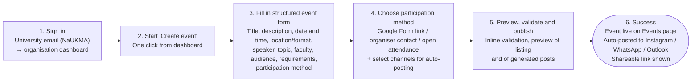

# 3.1 User Journey — Happy Path: Student Organisation Publishes an Event

**Persona:** Head of a NaUKMA student organisation (Student Organizations & Initiative Organizers)
**Example situation:** A renowned AI expert agrees to give a lecture; the organisation wants students to discover it and sign up.

**Path entry:** The head of the organisation opens AlmaMater with the intent to create a new event so students can register for the lecture.

**Path exit (success criteria):**
- The event is visible on the `Events` subpage.
- The event is automatically posted to the organisation's external channels (Instagram, WhatsApp, Outlook — per README R10).
- Zero form-input mismatches: the form contains every field the organiser needs.

## Happy Path Diagram

## Step Breakdown

| # | Step | What the user does | What the system does | Pain removed (README) |
|:--|:-----|:-------------------|:---------------------|:----------------------|
| 1 | Sign in | Logs in with the university email; lands on the organisation dashboard. | Verifies NaUKMA membership and the organisation role. | Spam and impersonation risk (R4). |
| 2 | Start "Create event" | Clicks a single, prominent "Create event" action. | Opens an empty structured form. | Time spent creating announcements across channels. |
| 3 | Fill in event details | Enters the lecture details once. Fields cover everything a student needs to evaluate fit: title, description, date/time, location or online link, speaker, topic, faculty, target audience, requirements, language, capacity (optional). | Validates as the user types; required fields are marked; sensible formats for date, time and links. | Incomplete announcements that lead to repeated questions; form-mismatch errors. |
| 4 | Choose participation method and channels | Picks how students join (external Google Form, contact the organiser, or open attendance) and ticks the social profiles for auto-posting. | Shows only the fields relevant to the chosen method (e.g. link field for Google Form). Uses the organisation's already-connected channels. | Inconsistent joining workflows (R7); duplicate work per channel (R10). |
| 5 | Preview, validate and publish | Checks the listing preview and the generated post text, then clicks "Publish". | Runs final validation and automated content checks (moderation); a moderator is only involved for edge cases. | Outdated or low-quality listings (R3, R4). |
| 6 | Success | Sees the confirmation and a shareable link to the listing. | Publishes the event on the `Events` subpage and automatically posts it to the selected external channels. | Fragmented information; low reach beyond current followers. |

## Notes and Assumptions

- The happy path assumes the organisation is already onboarded and its social media channels were connected once during onboarding. Connecting channels is not part of this flow.
- The happy path assumes automated moderation passes. Rejected or flagged listings belong to an alternative path.
- Registration is not handled inside AlmaMater in the MVP (README R7); the listing only directs students to the chosen participation method.
- Steps 3 and 4 are separate on purpose: they split a long form into a details part and a participation/distribution part, which keeps each screen short. They can be shown as two sections of one page if the team prefers a single-page form.
- Zero form-input mismatches depends on field design: the field list in step 3 should be validated with 2–3 real organisers before development.

## Open Questions for the Team

1. Which channels does auto-posting support at launch (Instagram, Telegram, WhatsApp, Outlook)? README R10 names Instagram, WhatsApp and Outlook, while the personas table names Instagram and Telegram.
2. Does the organiser edit the generated post text before it is sent, or is it fully automatic?
3. If an external post fails, should the event still be published on `Events` and the organiser be notified? (Assumed yes.)
4. Is pre-publication moderation blocking, or does it run after publication?
